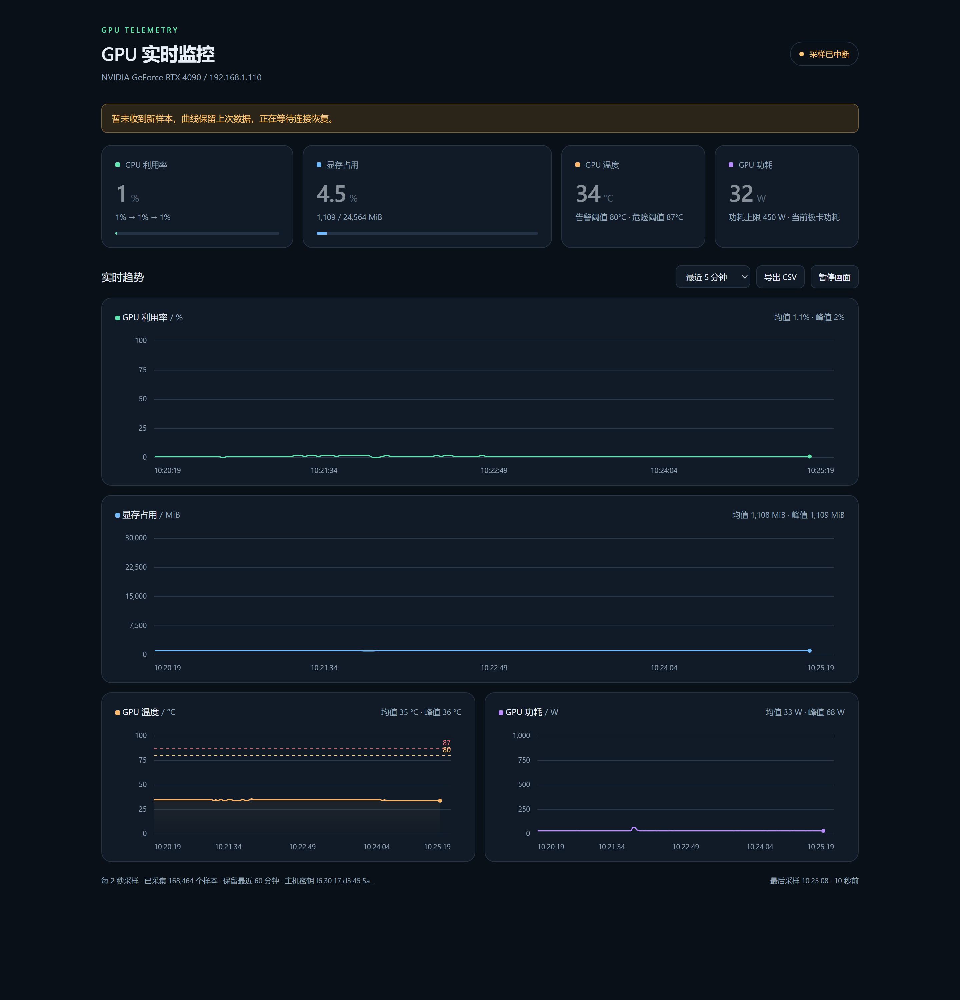

# Real-time GPU Monitoring Platform

> 通过 SSH 只读采样远程 NVIDIA GPU，在本机浏览器呈现实时遥测仪表盘。

[](https://www.python.org/)
[]()
[](LICENSE)
[](requirements.txt)

无需在远程主机安装 agent，也不需要开放额外端口：本机通过 SSH 执行 `nvidia-smi` 只读查询，把采样结果经本地 HTTP 服务推送到单页仪表盘。仪表盘仅监听 `127.0.0.1`。



---

## 目录

- [特性](#特性)
- [工作原理](#工作原理)
- [快速开始](#快速开始)
- [命令行参数](#命令行参数)
- [告警阈值](#告警阈值)
- [HTTP 接口](#http-接口)
- [安全设计](#安全设计)
- [故障排查](#故障排查)
- [文件结构](#文件结构)
- [License](#license)

---

## 特性

| 能力 | 说明 |
| --- | --- |
| **零侵入采样** | 远程只执行 `nvidia-smi --query-gpu`，不部署、不写盘、不改配置 |
| **四项核心指标** | 利用率、显存占用（% / MiB）、温度、功耗（含功耗上限） |
| **四条实时曲线** | 支持 5 / 15 / 60 分钟时间窗，原生 Canvas 绘制，无外部依赖 |
| **阈值告警** | 温度 80 °C 预警、87 °C 危险；显存 95% 高水位提示 |
| **断线自愈** | 连接或采样中断后 5 秒自动重连，界面明确标注当前状态 |
| **主机密钥固定** | 首次连接 TOFU 固化，密钥变更立即拒绝连接 |
| **数据导出** | 一键导出当前历史样本为 CSV，或持续追加写入本地文件 |
| **无第三方前端库** | 单文件 HTML + 原生 JS，离线可用 |

### 界面说明

- **顶部指标卡**：最新一次采样的瞬时值，附最近 5 个样本的极值区间。
- **趋势面板**：横轴为远程主机时间，悬停可读取精确数值；断线前后的样本按分段标记。
- **状态胶囊**：`实时采集中` / `采样已中断` / `登录失败` / `主机校验失败`，与失败原因一一对应。

---

## 工作原理

```text
┌──────────────┐   SSH (paramiko)    ┌──────────────────┐
│  本机浏览器   │◄──── HTTP ─────────│  app.py          │
│ 127.0.0.1    │                    │  ├─ Monitor 线程  │
└──────────────┘                    │  └─ HTTP Server  │
                                    └────────┬─────────┘
                                             │ nvidia-smi -l
                                    ┌────────▼─────────┐
                                    │  远程 GPU 主机    │
                                    └──────────────────┘
```

1. `Monitor` 线程建立 SSH 连接，启动一条长驻的 `nvidia-smi -l <interval>` 命令。
2. 逐行读取 CSV 输出，解析后写入内存环形缓冲区（容量由 `--history` 决定）。
3. HTTP 服务把缓冲区快照以 JSON 返回，前端每 2 秒轮询并重绘曲线。
4. 连接异常时写入 `disconnected` 状态并在 5 秒后重试；认证失败与主机密钥变更不重试。

---

## 快速开始

### 环境要求

- Python **3.9+**
- 远程主机已开启 SSH，且账号可执行 `nvidia-smi`
- 本机可直连远程主机的 SSH 端口

### 安装与启动

```bash
git clone https://github.com/HFAKER730/Real-time-GPU-Monitoring-Platform.git
cd Real-time-GPU-Monitoring-Platform
pip install -r requirements.txt
python app.py --host 192.168.1.110 --user sshuser --open
```

Windows 用户也可直接双击 `start.cmd`：脚本会自动检查依赖、避免重复启动，并在浏览器中打开 `http://127.0.0.1:8877`。

### 会话结束后继续运行

前台运行会随终端关闭而退出。需要长期驻留时，用 `pythonw`（Windows）或 `nohup` / `setsid`（Linux）脱离当前会话，并通过环境变量传入密码：

```bash
GPU_MONITOR_PASSWORD='<password>' nohup python3 app.py --host 192.168.1.110 > monitor.log 2>&1 &
```

```powershell
# Windows：通过 WMI 创建进程，避免被启动终端的 Job Object 回收
$startup = New-CimInstance -ClassName Win32_ProcessStartup -ClientOnly -Property @{ShowWindow=[uint16]0}
Invoke-CimMethod -ClassName Win32_Process -MethodName Create -Arguments @{
  CommandLine = '"C:\Path\To\pythonw.exe" "C:\Path\To\app.py" --host 192.168.1.110'
  CurrentDirectory = 'C:\Path\To\Real-time-GPU-Monitoring-Platform'
  ProcessStartupInformation = $startup
}
```

> 环境变量 `GPU_MONITOR_PASSWORD` 在进程启动时读取后立即从环境中移除，不会写入日志或文件。

---

## 命令行参数

| 参数 | 默认值 | 说明 |
| --- | --- | --- |
| `--host` | `192.168.1.100` | 远程主机地址 |
| `--user` | `sshuser` | SSH 用户名 |
| `--ssh-port` | `22` | SSH 端口 |
| `--port` | `8877` | 本机仪表盘端口（仅绑定 `127.0.0.1`） |
| `--gpu` | `0` | GPU 编号，对应 `nvidia-smi -i` |
| `--interval` | `2` | 采样间隔（秒） |
| `--history` | `60` | 内存中保留的历史分钟数 |
| `--log PATH` | 无 | 样本持续追加写入的 CSV 路径 |
| `--reset-key` | — | 删除已固化的远程主机密钥后退出 |
| `--open` | — | 启动后自动打开浏览器 |

### 示例

监控 1 号卡，每 5 秒采样，持续落盘并保留 30 分钟历史：

```bash
python app.py --host 192.168.1.50 --user nvidia --gpu 1 --interval 5 --history 30 --log logs/gpu.csv --open
```

多卡主机建议为每张卡各起一个实例（使用不同 `--port`）。

---

## 告警阈值

| 指标 | 预警 | 危险 | 行为 |
| --- | --- | --- | --- |
| GPU 温度 | ≥ 80 °C | ≥ 87 °C | 指标卡数字变色，温度曲线标注阈值线 |
| 显存占用 | ≥ 95% | — | 显存卡片变色并提示高水位 |

阈值定义在 `app.py` 顶部（`TEMP_WARN` / `TEMP_CRIT` / `MEMORY_WARN_PERCENT`），随 `/api/samples` 的 `config.thresholds` 下发给前端，修改后无需改动 HTML。

---

## HTTP 接口

| 路径 | 方法 | 说明 |
| --- | --- | --- |
| `/` | GET | 仪表盘页面 |
| `/api/samples` | GET | 当前快照：状态、最新样本、历史数组、阈值配置 |
| `/api/export.csv` | GET | 导出内存缓冲区内全部样本 |

`/api/samples` 响应结构概览：

```json
{
  "status": "live",
  "host": "192.168.1.110",
  "latest": {
    "remote_time": "2026/10/19 10:24:25.684",
    "utilization": 1.0,
    "memory_used": 10375,
    "memory_total": 24564,
    "memory_percent": 42.24,
    "temperature": 34.0,
    "power": 409.6,
    "power_limit": 450.0
  },
  "samples": [],
  "config": { "interval": 2, "history_minutes": 60, "thresholds": {} }
}
```

`status` 取值：`connecting`、`live`、`stale`、`disconnected`、`auth_error`、`host_key_error`。

---

## 安全设计

1. **只读远程操作** — 远程命令固定为 `nvidia-smi` 查询，不做任何写操作。
2. **回环绑定** — HTTP 服务仅监听 `127.0.0.1`，并校验 `Host` 请求头，非本机回环访问返回 403。
3. **密码不落盘** — 密码仅存在于进程内存；环境变量在读取后立即弹出。
4. **主机密钥固定** — 首次连接采用 TOFU（写入项目目录 `known_hosts`）；后续密钥变化会被判定为 `host_key_error` 并停止连接。确认是合法变更（如重装系统）后，执行 `python app.py --reset-key` 再重连。
5. **安全响应头** — 返回页面时附带 `Content-Security-Policy`、`X-Content-Type-Options: nosniff`、`Cache-Control: no-store`。

> 公网环境请勿使用弱密码；SSH 侧建议禁用密码登录，改用密钥认证。

---

## 故障排查

| 现象 | 可能原因 | 处理 |
| --- | --- | --- |
| 页面显示「本地采集服务不可用」 | `app.py` 未运行，或端口被旧实例占用 | 确认进程存在；`netstat -ano \| grep 8877` 检查端口 |
| 状态为 `登录失败` | 密码错误或账号无权限 | 重新启动并输入正确密码 |
| 状态为 `主机校验失败` | 远程主机密钥变化 | 确认安全后执行 `--reset-key` |
| 状态为 `采样已中断` 并反复重连 | 网络不通、SSH 端口错误、远程 `nvidia-smi` 不可用 | 手动 `ssh` 验证；在远程执行 `nvidia-smi -L` |
| 曲线空白但数值正常 | 采样间隔大于时间窗，或刚启动 | 等待积累样本；确认 `--interval` 小于窗口长度 |
| 中文乱码（Windows 终端） | 控制台编码非 UTF-8 | 先执行 `chcp 65001` |

查看运行日志：

```bash
tail -f monitor.log        # 以重定向方式启动时
```

---

## 文件结构

```text
Real-time-GPU-Monitoring-Platform/
├── app.py                     # SSH 采样 + HTTP 服务
├── index.html                 # 单文件仪表盘（原生 Canvas）
├── requirements.txt           # 依赖：paramiko>=3.0
├── start.cmd                  # Windows 一键启动（前台）
├── stop_dashboard.cmd         # Windows 停止监听进程
├── run_dashboard.cmd          # Windows 非交互式启动（读环境变量密码）
├── run_monitor_bg.py          # 后台启动器（读取密码文件后立即删除）
├── launch_detached.py         # 脱离终端的启动脚本
├── docs/
│   └── dashboard.png          # README 展示图
└── .gitignore
```

首次连接后会在项目目录生成 `known_hosts`；运行时可能生成 `monitor.log` 与导出的 CSV，这些文件已在 `.gitignore` 中排除。

---

## License

MIT
